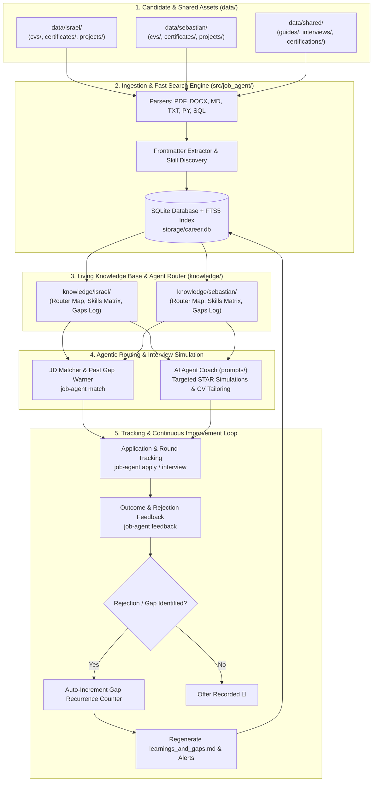

# Job Application Agent 🚀
### Multi-Candidate Job Hunt Management & Continuous Improvement System

An intelligent, multi-candidate platform built to coordinate job hunt workflows, automate resume tailoring, simulate high-stakes technical/behavioral interviews, and drive **continuous candidate improvement fueled by real interview and rejection feedback**.

Designed for **Israel** and his brother **Sebastian**, sharing a centralized technical knowledge base while maintaining strictly independent candidate profiles, application trackers, and improvement registries.

---

## 🎯 Architecture & System Flow



---

## 💡 Design Philosophy: Agentic Context Routing vs. Heavy RAG

Rather than introducing an over-engineered vector database (e.g., Qdrant, Chroma) and chunked embeddings that strip away the cohesive context of STAR behavioral stories, this platform implements **Agentic Context Routing & Metadata Navigation**:

1. **Structured Plaintext Over Opaque Binaries**:
   - Resumes are archived in PDF for external recruiter submissions, but all verified projects, case studies, and credential records are authored in Markdown (`.md`).
   - Plaintext enables instant scanning, heading hierarchy preservation, and negligible token overhead.
2. **Metadata Frontmatter Cards**:
   - Every project file starts with an executive frontmatter header (`title`, `company`, `role`, `tech_stack`, `key_metrics`, `core_topics`).
   - Agents read only the header to evaluate JD relevance in milliseconds without consuming context reading the entire file.
3. **Living Router Map (`profile.md`)**:
   - `knowledge/<candidate>/profile.md` serves as a GPS map for AI agents. It maps every verified project to its local filepath, allowing the agent to surgically load *only* the specific project needed to answer an interview question or craft tailored CV bullets.
4. **Zero Cross-Contamination**:
   - Personal projects and career history belong strictly to the individual (`data/<candidate>/projects/`).
   - `data/shared/` is reserved strictly for neutral materials: technical cheat sheets, interview frameworks, and study guides.
5. **Sub-Millisecond Hybrid Retrieval (FTS5)**:
   - SQLite FTS5 provides instantaneous full-text search across all documents with Porter stemming, zero cloud API fees, and zero hallucination risk.

---

## 🏗️ Step-by-Step Architectural Walkthrough

### Layer 1: Candidate Sources & Shared Knowledge (`data/`)
- **Strict Profile Boundaries**:
  - `data/sebastian/`: Personal resumes (`cvs/`), credential records (`certificates/`), and verified projects (`projects/`).
  - `data/israel/`: Israel's resumes (`cvs/`), credentials (`certificates/`), and verified projects (`projects/`).
- **Shared Technical Arsenal (`data/shared/`)**:
  - `guides/`: Concise cheat sheets for PySpark, Databricks, Delta Lake, dbt, SQL, Fabric, and Azure Data Factory.
  - `interviews/`: Interview question banks, English simulations, STAR framework guidelines, and interviewer questions.
  - `certifications/`: Databricks Associate and Professional exam preparation tracks.
  - `projects/`: Reference coding challenges and architecture templates.

### Layer 2: Relational Database & Full-Text Search (`storage/career.db`, `src/job_agent/db/`)
- Relational SQLite schema with FTS5 virtual tables:
  - `candidates`: Profile information, target roles, and email contacts.
  - `documents`: Ingested files, document types (`cv`, `certificate`, `project`, `note`, `shared`), SHA-256 hashes, and raw text.
  - `skills`: Detected technical competencies and estimated proficiencies.
  - `applications`: Job opportunities, company names, salary ranges, and application stages.
  - `interviews`: Round-by-round interview logs, questions asked, and candidate answers.
  - `feedbacks`: Rejection notes, recruiter emails, and self-reflections.
  - `gap_learnings`: Topic-specific registry of technical/behavioral weaknesses, recurrence counts, and action plans.

### Layer 3: Living Knowledge Base Synchronization (`knowledge/`)
- Every ingestion or feedback update dynamically synchronizes the candidate's personal markdown files:
  - `profile.md`: Living Router Map connecting target skills to specific project files.
  - `skills_matrix.md`: Categorized technical skill matrix with estimated proficiency.
  - `learnings_and_gaps.md`: Dedicated registry of interview weak spots, frequency of detection, and prioritized study roadmaps.

### Layer 4: Job Description Matching & Gap Prevention (`matcher.py`)
- Analyzes job postings before applying.
- Compares required technologies against candidate skills.
- **High-Priority Warning System**: Cross-references job requirements with `gap_learnings`. If a role demands an area where the candidate previously stumbled, it generates an alert with the recommended study plan.

### Layer 5: AI Prompts & Interview Simulation (`prompts/`)
- System prompts tailored for LLM agents (Antigravity IDE, Cursor, Claude, ChatGPT):
  - [agent_sebastian.md](file:///c:/Users/sebas/OneDrive/Documentos/GitHub/job-application-agent/prompts/agent_sebastian.md): Dedicated career coach and interview partner for Sebastian.
  - [agent_israel.md](file:///c:/Users/sebas/OneDrive/Documentos/GitHub/job-application-agent/prompts/agent_israel.md): Dedicated career coach for Israel.
  - [cv_tailor.md](file:///c:/Users/sebas/OneDrive/Documentos/GitHub/job-application-agent/prompts/cv_tailor.md): Generates Google impact-formula resume bullets tailored to specific JDs.
  - [feedback_analyzer.md](file:///c:/Users/sebas/OneDrive/Documentos/GitHub/job-application-agent/prompts/feedback_analyzer.md): Diagnoses root cause of rejections and outputs CLI commands.
  - [interview_prep.md](file:///c:/Users/sebas/OneDrive/Documentos/GitHub/job-application-agent/prompts/interview_prep.md): Conducts mock interviews focusing on candidate weak spots.

---

## 📁 Directory Structure

```text
job-application-agent/
├── AGENTS.md                          # Mandatory operating rules and language policies
├── README.md                          # System guide, architecture, and roadmap
├── job-application-agent.code-workspace # VS Code / Antigravity IDE workspace setup
├── pyproject.toml                     # Project packaging and dependencies (UV)
│
├── config/
│   ├── settings.toml                  # App configurations, database paths, extensions
│   └── candidates.toml                # Registered candidates (Israel, Sebastian)
│
├── data/                              # SOURCE INPUT ASSETS
│   ├── sebastian/                     # Sebastian's personal assets
│   │   ├── cvs/                       # Resumes in PDF / Word / Markdown
│   │   ├── certificates/              # Certifications and credentials
│   │   └── projects/                  # Verified production projects with frontmatter
│   ├── israel/                        # Israel's personal assets
│   │   ├── cvs/                       # Resumes in PDF / Word / Markdown
│   │   ├── certificates/              # Certifications and credentials
│   │   └── projects/                  # Verified production projects with frontmatter
│   └── shared/                        # Neutral shared technical knowledge
│       ├── guides/                    # Tech cheat sheets (PySpark, Databricks, dbt, SQL)
│       ├── interviews/                # Question banks, English mock prep, STAR guides
│       ├── certifications/            # Databricks certification study guides
│       └── projects/                  # Coding challenge templates & reference repos
│
├── storage/
│   ├── schema.sql                     # SQLite DDL schema with FTS5 virtual tables
│   └── career.db                      # Local database (untracked by Git)
│
├── knowledge/                         # AUTO-GENERATED CANDIDATE INTELLIGENCE
│   ├── sebastian/                     # profile.md (Router), skills_matrix.md, learnings_and_gaps.md
│   └── israel/                        # profile.md (Router), skills_matrix.md, learnings_and_gaps.md
│
├── prompts/                           # LLM SYSTEM PROMPTS
│   ├── agent_sebastian.md             # System prompt for Sebastian's coach
│   ├── agent_israel.md                # System prompt for Israel's coach
│   ├── interview_prep.md              # Technical and behavioral mock interview coach
│   ├── feedback_analyzer.md           # Rejection & gap analysis prompt
│   └── cv_tailor.md                   # Job description CV customizer
│
├── src/job_agent/                     # PYTHON SOURCE CODE
│   ├── cli.py                         # Click CLI command-line interface
│   ├── config.py                      # Path resolving and configuration loaders
│   ├── core/                          # Business logic: matcher, tracker, feedback loop
│   ├── db/                            # SQLite connection, repositories, models
│   ├── ingestion/                     # Parsers and multi-candidate ingestion pipeline
│   └── reports/                       # Rich console dashboard
│
└── tests/                             # Automated test suite
```

---

## ⚡ Quickstart & CLI Reference

### 1. Installation
Ensure you have Python 3.12+ and [uv](https://docs.astral.sh/uv/) installed:
```powershell
# Clone the repository
git clone https://github.com/isrita/job-application-agent.git
cd job-application-agent

# Install dependencies into virtual environment
uv sync
```

### 2. Verify System Health
```powershell
uv run python -m job_agent doctor
```

### 3. Ingest Documentation & Synchronize Knowledge Bases
```powershell
# Ingest everything (all candidates + shared guides and projects)
uv run python -m job_agent ingest

# Ingest specific candidate
uv run python -m job_agent ingest -c sebastian
uv run python -m job_agent ingest -c israel
```

### 4. Terminal Visual Dashboard
```powershell
uv run python -m job_agent dashboard -c sebastian
```

### 5. Match a Job Description (Pre-Application Check)
```powershell
uv run python -m job_agent match -c sebastian -t "Seeking Senior Data Engineer with Snowflake, dbt, Airflow, and PySpark."
```

### 6. Track an Application & Interview Round
```powershell
# Register application
uv run python -m job_agent apply -c sebastian --company "Tech Scaleup" --role "Senior Data Engineer" --salary "100k-120k USD" --location "Remote"

# Record an interview round
uv run python -m job_agent interview --app-id 1 -c sebastian --stage "tech_round_1" --questions "How do you handle schema evolution in Delta Lake?" --answers "Detailed STAR response on merge schema."
```

### 7. Record Rejection Feedback & Continuous Improvement
```powershell
uv run python -m job_agent feedback -c sebastian -o rejected -f "Strong architectural foundations, but needed deeper hands-on Kafka streaming." -g "Kafka Partitioning; Consumer Rebalancing" -a "Build local Kafka docker lab" --app-id 1
```

### 8. Full-Text Search (FTS5)
```powershell
uv run python -m job_agent search "Delta Lake" -c sebastian
uv run python -m job_agent search "Scout"
```

### 9. Run Test Suite
```powershell
uv run python -m unittest discover -s tests
```

---

## 📜 Operating Rules for Collaborators & Agents

1. **Language Policy**:
   - All code, docstrings, CLI output, markdown files, and commit messages **MUST ALWAYS BE IN ENGLISH**.
   - You may interact with the AI assistant in either English or Spanish, but workspace files remain strictly English.
2. **Strict Profile Separation**:
   - Sebastian's assets reside in `data/sebastian/` and `knowledge/sebastian/`.
   - Israel's assets reside in `data/israel/` and `knowledge/israel/`.
   - Shared technical guides and interviews reside in `data/shared/`.
3. **Data Integrity & Privacy**:
   - Never commit `storage/career.db`, `.env`, or personal contact details into version control.
   - Never fabricate projects or skills not backed by files in `data/`.
