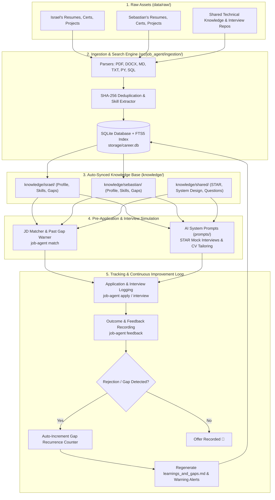

# Job Application Agent 🚀
### Multi-Candidate Job Hunt Management & Continuous Improvement System

An intelligent, multi-candidate platform built to coordinate job hunt workflows, automate resume tailoring, simulate high-stakes technical/behavioral interviews, and drive **continuous candidate improvement fueled by real interview and rejection feedback**.

Designed for **Israel** and his brother **Sebastian**, sharing a centralized technical knowledge base while maintaining strictly independent candidate profiles, application trackers, and improvement registries.

---

## 🎯 Architecture & System Flow



---

## 🏗️ Step-by-Step Architectural Walkthrough

### Layer 1: Ingestion & Document Repository (`src/job_agent/ingestion/`)
- **Raw File Storage**: Documents reside in `data/raw/<candidate>/` (resumes, diplomas, notes) and `data/raw/shared/` (certifications, coding challenges, system design notes).
- **Parsers (`parsers.py`)**: Safely parses text, metadata, and code structures from `.pdf`, `.docx`, `.md`, `.txt`, `.json`, `.py`, `.sql`, `.yaml`, and `.ts`.
- **SHA-256 Incremental Deduplication**: Computes content hashes. Re-running ingestion is fast and only processes added or modified files.
- **Skill Extraction Catalog**: Heuristic pattern-matching engine that discovers skills across Data Engineering, Cloud Infrastructure, Programming, Databases, BI, and Methodologies.

### Layer 2: Relational Database & Full-Text Search (`storage/schema.sql`, `src/job_agent/db/`)
- Relational schema in SQLite (`storage/career.db`):
  - `candidates`: Profile information, target roles, and emails.
  - `documents`: Ingested files, document types (`cv`, `certificate`, `project`, `note`, `shared`), hashes, and raw text.
  - `skills`: Detected technical competencies and estimated proficiencies.
  - `applications`: Job opportunities, company names, salary ranges, and application stages.
  - `interviews`: Round-by-round interview logs, questions asked, and candidate answers.
  - `feedbacks`: Rejection notes, recruiter emails, and self-reflections.
  - `gap_learnings`: Topic-specific registry of technical/behavioral weaknesses, recurrence counts, and action plans.
- **SQLite FTS5 (Full-Text Search)**: High-speed full-text index across all documents, interview rounds, and notes with Porter stemming and tokenization.

### Layer 3: Knowledge Base Auto-Synchronization (`knowledge/`)
- Every ingestion or feedback update dynamically updates the candidate's markdown files:
  - `profile.md`: Current document inventory, certificates, and portfolio.
  - `skills_matrix.md`: Categorized technical skill matrix with estimated proficiency.
  - `learnings_and_gaps.md`: Living record of interview gaps, frequency of detection, and prioritized study roadmaps.

### Layer 4: Job Description Matching & Gap Prevention (`matcher.py`)
- Analyzes job postings before applying.
- Compares required technologies against candidate skills.
- **High-Priority Warning System**: Cross-references job requirements with `gap_learnings`. If a role demands an area where the candidate previously stumbled, it generates an alert with the recommended study plan.

### Layer 5: AI Prompts & Interview Simulation (`prompts/`)
- System prompts for LLMs (Antigravity IDE, Cursor, Claude, ChatGPT):
  - [agent_israel.md](file:///c:/Users/IsraelJesusBonillaDe/Documents/job-application-agent/prompts/agent_israel.md): Personal career coach for Israel.
  - [agent_sebastian.md](file:///c:/Users/IsraelJesusBonillaDe/Documents/job-application-agent/prompts/agent_sebastian.md): Personal career coach for Sebastian.
  - [cv_tailor.md](file:///c:/Users/IsraelJesusBonillaDe/Documents/job-application-agent/prompts/cv_tailor.md): Generates Google impact-formula resume bullets tailored to specific JDs.
  - [feedback_analyzer.md](file:///c:/Users/IsraelJesusBonillaDe/Documents/job-application-agent/prompts/feedback_analyzer.md): Diagnoses root cause of rejections and outputs CLI commands.
  - [interview_prep.md](file:///c:/Users/IsraelJesusBonillaDe/Documents/job-application-agent/prompts/interview_prep.md): Conducts mock interviews focusing on candidate weak spots.

---

## 📁 Directory Structure

```text
job-application-agent/
├── AGENTS.md                          # Mandatory operating rules and language policies
├── README.md                          # System guide, architecture, and roadmap
├── job-application-agent.code-workspace # VS Code / Antigravity IDE workspace setup
├── pyproject.toml                     # Project packaging and dependencies (UV)
│
├── config/
│   ├── settings.toml                  # App configurations, database paths, extensions
│   └── candidates.toml                # Registered candidates (Israel, Sebastian)
│
├── data/raw/                          # RAW ASSET SOURCE
│   ├── israel/                        # Israel's resumes, certificates, notes
│   ├── sebastian/                     # Sebastian's resumes, certificates, notes
│   └── shared/                        # Shared knowledge base
│       ├── certifications/databricks/ # Complete Databricks Associate & Professional study guides
│       ├── frameworks/                # STAR framework and interview strategies
│       └── projects/                  # Real interview coding challenge repositories
│
├── storage/
│   ├── schema.sql                     # SQLite DDL schema with FTS5 virtual tables
│   └── career.db                      # Local database (untracked by Git)
│
├── knowledge/                         # AUTO-GENERATED MARKDOWN KNOWLEDGE BASES
│   ├── israel/                        # Profile, skills matrix, and learnings/gaps for Israel
│   ├── sebastian/                     # Profile, skills matrix, and learnings/gaps for Sebastian
│   └── shared/                        # System design cheat sheets & interviewer questions
│
├── prompts/                           # LLM SYSTEM PROMPTS
│   ├── agent_israel.md                # System prompt for Israel's agent
│   ├── agent_sebastian.md             # System prompt for Sebastian's agent
│   ├── interview_prep.md              # Technical and behavioral mock interview coach
│   ├── feedback_analyzer.md           # Rejection & gap analysis prompt
│   └── cv_tailor.md                   # Job description CV customizer
│
├── src/job_agent/                     # PYTHON SOURCE CODE
│   ├── cli.py                         # Click CLI command-line interface
│   ├── config.py                      # Path resolving and configuration loaders
│   ├── core/                          # Business logic: matcher, tracker, feedback loop
│   ├── db/                            # SQLite connection, repositories, models
│   ├── ingestion/                     # Parsers and multi-candidate ingestion pipeline
│   └── reports/                       # Rich console dashboard
│
└── tests/                             # Automated test suite
```

---

## ⚡ Quickstart & CLI Reference

### 1. Installation
Ensure you have Python 3.12+ and [uv](https://docs.astral.sh/uv/) installed:
```powershell
# Clone the repository
git clone https://github.com/isrita/job-application-agent.git
cd job-application-agent

# Install dependencies into virtual environment
uv sync
```

### 2. Verify System Health
```powershell
uv run python -m job_agent doctor
```

### 3. Ingest Documentation & Projects
```powershell
# Ingest everything (all candidates + shared documents and projects)
uv run python -m job_agent ingest

# Ingest specific candidate
uv run python -m job_agent ingest -c israel
uv run python -m job_agent ingest -c sebastian
```

### 4. Terminal Visual Dashboard
```powershell
uv run python -m job_agent dashboard
```

### 5. Match a Job Description (Pre-Application Check)
```powershell
uv run python -m job_agent match -c israel -t "Seeking Senior Data Engineer with Databricks, PySpark, Azure Data Factory, and Kafka."
```

### 6. Track an Application & Interview Round
```powershell
# Register application
uv run python -m job_agent apply -c israel --company "Tech Corp" --role "Senior Data Engineer" --salary "120k-140k USD" --location "Remote"

# Record an interview round
uv run python -m job_agent interview --app-id 1 -c israel --stage "tech_round_1" --questions "How do you handle small files in Delta Lake?" --answers "Explained OPTIMIZE and Z-ORDER."
```

### 7. Record Rejection Feedback & Continuous Improvement
```powershell
uv run python -m job_agent feedback -c israel -o rejected -f "Strong in SQL, but struggled with Kafka partitioning and consumer rebalancing." -g "Kafka Partitioning: consumer groups and partition rebalancing" -a "Build practical lab on Databricks with Kafka" --app-id 1
```

### 8. Full-Text Search (FTS5)
```powershell
uv run python -m job_agent search "Liquid Clustering"
uv run python -m job_agent search "Dagster"
```

### 9. Run Test Suite
```powershell
uv run python -m unittest discover -s tests
```

---

## 📋 Roadmap: Remaining Steps for Sebastian to Complete

To take this platform to 100% completion and make it an autonomous end-to-end job hunting system, here are the exact tasks prioritized for **Sebastian**:

### 🎯 Task 1: Direct LLM Client Integration (`src/job_agent/ai/`)
- **Current State**: System prompts exist in `prompts/`, but the user currently pastes them manually into an AI chat or IDE.
- **Goal**: Create an AI client module (`src/job_agent/ai/client.py`) that uses the API keys defined in `.env` (`OPENAI_API_KEY`, `ANTHROPIC_API_KEY`, `GEMINI_API_KEY`).
- **CLI Command to build**:
  ```powershell
  uv run python -m job_agent interview mock -c sebastian --app-id 2
  ```
  This command should load the candidate's profile, past gaps, and the target JD, and conduct an interactive terminal mock interview.

### 🎯 Task 2: Automated Job Description Scraper (`src/job_agent/ingestion/scrapers.py`)
- **Current State**: `job-agent apply` and `job-agent match` accept text strings or local files.
- **Goal**: Allow passing a job posting URL directly:
  ```powershell
  uv run python -m job_agent match -c sebastian --url "https://jobs.lever.co/example/123"
  ```
  Support HTML parsing for LinkedIn, Greenhouse, Lever, and Workday postings to automatically extract title, company, requirements, and salary range.

### 🎯 Task 3: ATS-Optimized PDF Resume Generator (`src/job_agent/reports/cv_generator.py`)
- **Current State**: Resume tailoring instructions exist in `prompts/cv_tailor.md`.
- **Goal**: Build a generator that takes the candidate's skills and tailored bullets and exports a clean, single-page PDF resume using ReportLab, Typst, or LaTeX:
  ```powershell
  uv run python -m job_agent export-cv -c sebastian --app-id 2 --output "cv_sebastian_custom.pdf"
  ```

### 🎯 Task 4: Interactive Web Kanban Board (Optional GUI)
- **Current State**: Visual dashboard is rendered in the terminal using Rich.
- **Goal**: Create a lightweight web dashboard (using FastAPI + HTML/Tailwind or Streamlit) showing a drag-and-drop Kanban board:
  - Columns: `Applied` ➔ `Screening` ➔ `Tech Round` ➔ `Final Round` ➔ `Offer` / `Rejected`.
  - Visual charts showing the most recurring technical gaps and success rates.

### 🎯 Task 5: Automated GitHub Actions CI Workflow (`.github/workflows/ci.yml`)
- **Goal**: Add continuous integration on GitHub that automatically runs:
  - `uv sync`
  - `uv run python -m unittest discover -s tests`
  - Code formatting check with `ruff` or `flake8`.

---

## 📜 Operating Rules for Collaborators & Agents

1. **Language Policy**:
   - All code, docstrings, CLI output, markdown files, and commit messages **MUST ALWAYS BE IN ENGLISH**.
   - You may interact with the AI assistant in either English or Spanish, but project files remain strictly English.
2. **Strict Profile Separation**:
   - Israel's data resides in `data/raw/israel/` and `knowledge/israel/`.
   - Sebastian's data resides in `data/raw/sebastian/` and `knowledge/sebastian/`.
   - Shared data resides in `data/raw/shared/` and `knowledge/shared/`.
3. **Privacy & Security**:
   - Never commit `storage/career.db`, `.env`, or sensitive credentials into Git.
