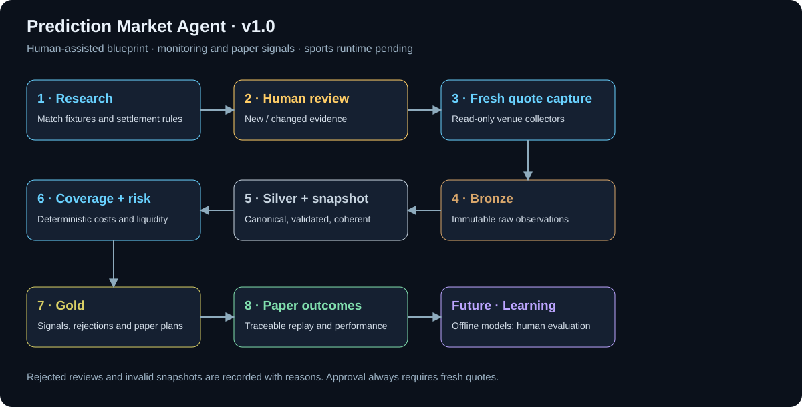
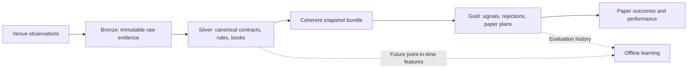
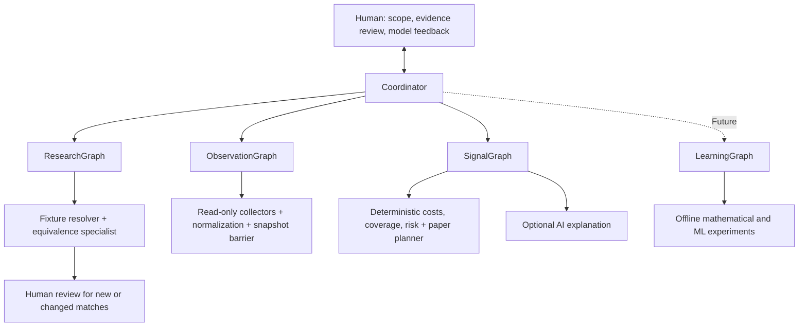

# Prediction Market Agent · v1.0

**Human-assisted sports arbitrage research across prediction markets.** Compare equivalent contracts, retain evidence, and prepare monitoring signals and paper plans. A price gap alone is not proof of arbitrage.

Version 1.0 is a **foundation release**: an offline architecture blueprint, proposed medallion schema, manual catalog adapter, and isolated working reference interface. The sports LangGraph runtime, live sports connectors, and signal engine are not yet implemented. No automated trading is enabled in the sports core.

## Operating workflow



The coordinator scopes a request. Research matches fixtures and settlement rules. New or changed equivalence proposals require human evidence review; previously approved, unchanged fingerprints may reuse that review. Approval leads to **fresh quote collection**, not permission to trade. Rejections and invalid data remain visible in the audit trail.

The initial development cycle is deliberate: review one fixture pair, capture data, replay it offline, inspect the calculated result, and refine the policy with a human. Model changes are versioned and evaluated before adoption.

### Mapping the Predictefy template to sports

| Template component | Sports equivalent | Data layer |
| --- | --- | --- |
| Predictefy + Kalshi inputs | Venue contracts, settlement rules, quotes, and books | Bronze: original observations |
| Frozen snapshot | Reviewed contracts and normalized books within a coherent capture window | Silver: validated snapshot |
| Math model | Complete payout coverage, executable costs, fees, and liquidity | Reads Silver; writes Gold |
| GPT decision | Rules-review assistance and optional explanation | Reviewed knowledge and Gold evidence |
| Risk checks | Freshness, exposure, depth, and coverage policy | Gold: checks and rejection reasons |
| One order | Multi-leg paper plan across venues | Gold: proposed legs; no orders |
| Settlement | Outcome reconciliation and paper performance | Bronze → Silver → Gold |

The BTC template estimates an outcome probability. The sports design first calculates coverage across equivalent contracts. Predictive mathematics and ML are future research stages.

## Data architecture



- **Bronze:** provider payloads, capture timestamps, and provenance; append-only.
- **Silver:** canonical fixtures, versioned settlement rules, outcome mappings, Decimal prices, and executable depth.
- **Gold:** cost and coverage results, policy decisions, human review references, paper plans, and outcomes.

The proposed local implementation uses SQLite market records and a **separate LangGraph checkpoint database**. Workflow checkpoints preserve execution progress; medallion records preserve analytical evidence. The schema is supplied, not deployed. Cloud lakehouse migration follows measured volume and concurrency requirements.

## AI agent architecture



| Workflow | Responsibility | Decision boundary |
| --- | --- | --- |
| Research | Scope, fixture identity, contract equivalence | AI proposes; human approves new/changed evidence |
| Observation | Read-only capture, Bronze/Silver, coherent snapshot | Code rejects stale, incomplete, or invalid data |
| Signals | Costs, coverage, risk, Gold records, paper plans | Deterministic Decimal calculations |
| Learning — future | Point-in-time features, mathematical models, ML evaluation | Human-reviewed experiments; no financial-policy override |

Not every specialist requires an LLM. Transport, cleaning, financial calculations, and persistence are deterministic. Proposed economy/balanced model profiles remain configurable; automatic model calls are disabled. Reviewed rule fingerprints can be cached, while quote ticks do not trigger model calls.

## Repository scaffold

```text
prediction-market-agent/
├── .github/workflows/       # Offline CI checks
├── apps/kalshi-btc15m/      # Isolated reference interface and tests
├── config/                 # Graph, agent, model, storage, and venue registry
├── docs/                   # Architecture, contracts, integrations, roadmap
│   └── assets/             # Maintained flow image
├── knowledge/              # Project context and architecture decisions
├── market_agent/           # Python contracts, CLI, blueprint, catalog adapter
├── prompts/                # Bounded English specialist instructions
├── storage/schema.sql      # Proposed medallion DDL
├── tests/                  # Offline Python tests
├── AGENTS.md               # Development and execution boundaries
├── CHANGELOG.md
├── CONTRIBUTING.md
├── SECURITY.md
├── pyproject.toml / uv.lock
└── package.json / package-lock.json
```

Local credentials, dependencies, runtime files, databases, and retired prototype ZIPs are excluded from Git. Source-only rollback archives remain local.

## Quick start

Requirements: Python 3.11+, uv, and Node 24+ for the reference app.

```powershell
git clone https://github.com/isrita/prediction-market-agent.git
cd prediction-market-agent
uv sync --locked
npm ci --prefix apps/kalshi-btc15m
uv run --locked python -m market_agent doctor
uv run --locked python -m market_agent blueprint
uv run --locked python -m market_agent context market_equivalence
uv run --locked python -m market_agent plan --task "Review equivalent sports contracts across two venues"
npm run dev
```

Open http://127.0.0.1:8770 and select **Replay example**. This is the working **Kalshi BTC reference**, using demonstration data; the sports UI is a planned adaptation. Offline planning commands report `prepared_not_executed` and do not call APIs, models, or order endpoints.

### Validation

```powershell
uv run --locked python -m unittest discover -s tests -v
npm test
npm run check
```

The foundation currently has 22 Python tests and 40 reference-app tests. CI runs these checks without credentials or real orders.

### Optional manual catalog request

Copy `.env.example` to ignored `.env` and enter a read-only key locally. Never commit credentials.

```powershell
uv run --env-file .env --locked python -m market_agent predictefy status
uv run --env-file .env --locked python -m market_agent predictefy markets --limit 3
```

`status` is local. `markets` makes one authenticated, metered catalog request. Existing catalog verification does not establish sports coverage, matching rules, executable books, or profitable signals. Nothing polls automatically.

## Implementation status and next steps

| Component | v1.0 status |
| --- | --- |
| Offline registry, doctor, context, plan, blueprint | Implemented |
| Manual Predictefy catalog adapter | Implemented; prior catalog authentication verified |
| Kalshi reference interface and dry-run logic | Implemented and isolated |
| Human-assisted sports workflow | Designed; runtime pending |
| Sports adapters, coherent capture, coverage engine | Pending |
| LangGraph runtime and durable checkpoints | Pending |
| Medallion database | Proposed DDL; deployment pending |
| ML, cloud lakehouse, automated sports trading | Deferred |

Next: select one fixture and two venues, verify read-only capabilities, implement bounded capture and persistence, reproduce calculations offline, then wire human review and recovery into LangGraph. Human approval verifies evidence; it never authorizes an order in this version.

## Detailed documentation

- [Architecture and conditional workflow](docs/architecture.md)
- [Sports contracts and signal definitions](docs/contracts.md)
- [Medallion data platform](docs/data-platform.md)
- [Development roadmap](docs/development-roadmap.md)
- [Predictefy integration](docs/integrations/predictefy.md)
- [Reference application](apps/kalshi-btc15m/README.md)
- [Cleanup history](docs/cleanup.md)
- [Contribution guide](CONTRIBUTING.md) · [Security](SECURITY.md) · [Changelog](CHANGELOG.md)
