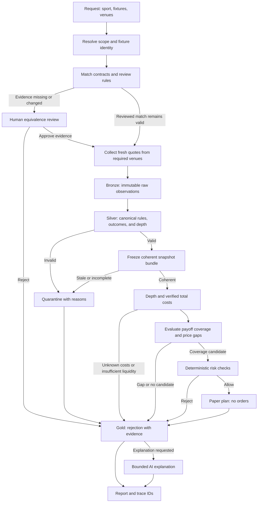

# Sports arbitrage orchestration architecture

Status: **proposed architecture with an offline blueprint**, October 3, 2026.
The graph runtime, live sports adapters, database, and signal engine are not yet
implemented. The initial mode is monitoring and paper signals.

## From the Predictefy example to sports

| Reference example | Sports implementation |
| --- | --- |
| Binance stream and one Kalshi target | Fixture catalog, rules, and books from each selected venue |
| One snapshot at minute 5 | Event-driven snapshot barrier across all required legs |
| Gaussian P(UP) | Deterministic payout matrix and depth-aware net coverage margin |
| One generative-AI decision | AI rule review and optional explanation of computed signals |
| Stake, daily loss, and floor checks | Configurable exposure, liquidity, freshness, and paper-risk policy |
| One IOC and BTC settlement | Non-executing multi-leg paper plan and settlement reconciliation |

The existing BTC example stays in `apps/kalshi-btc15m` as a visual and operational
reference. Its pricing model and 15-minute cadence do not become sports defaults.

## Four graph boundaries

1. **ResearchGraph** scopes requests, resolves fixtures, and proposes contract
   equivalence. Reviewed rules are cached by contract version and fingerprint.
   Ambiguity enters `human_approval`; a human approves the evidence or rejects it.
2. **ObservationGraph** reads selected venues concurrently, persists raw evidence,
   normalizes identities and depth, and freezes one coherent snapshot bundle.
   Invalid records enter quarantine rather than being replaced by old quotes.
3. **SignalGraph** computes payout coverage and costs, checks deterministic policy,
   and writes candidates, rejections, and paper plans. Explanations are optional.
4. **LearningGraph**, later, builds point-in-time features and evaluates models
   offline. Forecasts enrich research; they cannot turn incompatible contracts or
   incomplete outcome coverage into arbitrage.

The coordinator delegates a bounded request to these graphs and returns evidence
IDs and a compact result. Each specialist has its own context and thread namespace.
Use scan IDs for observations and snapshot IDs for calculations; do not pass full
raw payloads, keys, or unrelated conversations into LLM context.

Human approval reviews **contract equivalence**, not order execution. Once resumed,
collect new quotes; quotes captured before a long review are not actionable.
The blueprint is declared in `config/architecture.toml` and inspected with
`python -m market_agent blueprint`. It validates graph references and required
review/data-quality routes without running LangGraph.

## Responsibilities and model policy

| Owner | Work | Runtime type |
| --- | --- | --- |
| Coordinator | Scope and assembled report | Balanced LLM, requested tasks only |
| Fixture resolver | Identity and aliases | Deterministic; ambiguous aliases require review |
| Equivalence specialist | Rules comparison and evidence proposal | Balanced LLM on cache misses |
| Human reviewer | Explicit review decision and provenance | Human input recorded by code |
| Venue collectors | Capabilities, rules, executable books | Deterministic read-only adapters |
| Bronze writer / Silver builder | Persistence, normalization, lineage | Deterministic |
| Observation validator / snapshot barrier | Freshness, completeness, consistency | Deterministic |
| Cost / signal / risk specialists | Payout matrix, fees, depth, policy | Deterministic Decimal calculations |
| Paper planner / audit writer | Paper legs and reproducible outcomes | Deterministic |
| Analyst | Explain stored evidence in English | Economy LLM, optional |
| Learning researcher | Future offline experiments | Bounded LLM assistance; models evaluated separately |

Existing model profiles are retained as proposals: economy `gpt-6-luna`, low
reasoning; balanced `gpt-6.1-sol`, medium reasoning. The BTC example retains its
separate `gpt-6-sol` CLI configuration. Account access and quality evaluation are
still required. No fresh pricing assumption or paid call is introduced today.
Cache rules reviews; spend the larger profile on ambiguous rules, not quote ticks.
The current policy has automatic calls disabled and no approved model budget.
Before enabling models, implement per-run limits, a daily spend cap, token usage
logging, cache keys, and a fallback to deterministic reports.

## Persistence, recovery, and observability

Proposed LangGraph persistence uses a durable local SQLite checkpointer for
thread state, separate from market records. A persistent store or database holds
reviewed contract knowledge across threads. An in-memory saver is only for tests;
it does not survive restarts. This follows the official distinction between
[checkpointers and stores](https://docs.langchain.com/oss/python/langgraph/persistence).

The human-review node will use `interrupt()` and resume with the same thread ID.
Validate the resume payload and evidence fingerprint. Operations before the
interrupt must be idempotent because the node restarts on resume, as documented
in [LangGraph interrupts](https://docs.langchain.com/oss/python/langgraph/interrupts).

Observation writes deduplicate by venue, market, provider observation ID or payload
hash, and capture identity. Every transition records scan ID, contract version,
policy version, snapshot ID, timestamps, and reason codes. Restarting reuses stored
IDs; it does not silently replay requests, paid LLM calls, or paper decisions.
Use bounded per-venue timeouts and rate budgets; a partial snapshot never reaches
coverage evaluation. Provider failure affects all venues sharing that provider.

## Repository responsibilities

- `market_agent/`: core contracts, configuration, offline planning, integration
  adapters, and the validated workflow blueprint.
- `config/`: role, model, graph, storage, and venue registry.
- `prompts/`: scoped English instructions for AI specialists.
- `storage/schema.sql`: proposed local medallion schema, not a deployed database.
- `docs/`: architecture, contracts, data design, integrations, and next-session plan.
- `knowledge/`: persistent project context and architecture decisions.
- `tests/`: offline contract, integration, graph, and schema checks.
- `apps/kalshi-btc15m/`: isolated reference example and visual template.
- `archive/prototypes/`: retired source-only prototypes and superseded documents.

Next-session work is in [development-roadmap.md](development-roadmap.md).
