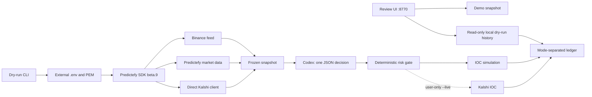

# Kalshi BTC 15M

`apps/kalshi-btc15m` is an independent application within
`prediction-market-agent`. It has its own SDK, lockfile, state, tests, and port,
so it does not change the Polymarket Copy Bot.

The interface is the first review stage and provides no execution controls.
Authenticated commands begin with a balance read. The Kalshi client signs locally;
`venueFetch` replaces only the exact `external-api.kalshi.com` origin with
`api.elections.kalshi.com`, preserving the path, query, and body.

The normalized catalog resolves the YES `outcomeId` before reading the order book.
Orders retain the native ticker. Before submission, the process reads the book and
`exchange_index=2` balance again. Code enforces limits independently of the AI.

See the [application README](../apps/kalshi-btc15m/README.md) for installation,
credentials, and commands. The interface, documentation, terminal messages, and AI
reasons use English; the daily reset time zone remains `America/Lima`.

## Continuity and review

The **Dry-run history** panel shows dry-mode state and recent local events.
Loading is manual and does not query markets. Demonstration metrics remain
labeled; an empty history does not represent a successful run with real data.

The ledger claims each window before calling Codex, retains the last five
decisions, and prevents repeated calls after a restart. A lock excludes concurrent
processes. Dry-mode funds start from the observed Crypto balance and subsequently
apply simulated PnL; real gains do not offset simulated losses.

Reservations are saved with fsync before submission. Incomplete responses remain
pending rather than being interpreted as zero fills. Reconciliation requires an
identified terminal order and its fills, with verified quantities and fees.
STOP interrupts waits and cancels Codex; a submitted order retains its reservation.

After the AI response, the bot validates the ticker, status, Crypto shard, BTC
price, book, and balance again. Proposed worst-case exposure cannot exceed the
remaining daily budget. A run with `--windows=1` waits for the close. If settlement
has not been published, the reservation is retained for the next startup.

Codex is invoked as a native executable with stdin closed, without a shell or
inherited rules. It receives only strategy instructions and the snapshot. The
external `.env` and RSA PEM paths are validated outside the entire repository.

Validation status: 40 offline tests passed, including snapshot creation, decision,
risk checks, simulated IOC, restart behavior, and simulated settlement. An
authenticated balance check, real snapshot, and complete dry-run window with real
data remain pending external `.env` and private PEM configuration. No orders have
been submitted and live mode has not been activated.
